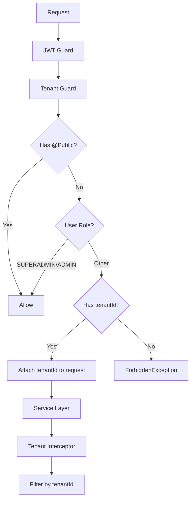

# Tenant Isolation & Multi-Tenancy

## Overview

This lesson explains how multi-tenancy is implemented in the Mechanic App, ensuring that users can only access data from their own organization/tenant.

---

## Architecture



---

## Components

### 1. TenantGuard

The `TenantGuard` is applied globally and enforces tenant isolation:

```typescript
// src/common/guard/tenant.guard.ts
@Injectable()
export class TenantGuard implements CanActivate {
  canActivate(context: ExecutionContext): boolean {
    // Check if route is public
    const isPublic = this.reflector.getAllAndOverride<boolean>(IS_PUBLIC_KEY, [
      context.getHandler(),
      context.getClass(),
    ]);

    if (isPublic) return true;

    const request = context.switchToHttp().getRequest();
    const user = request.user;

    // Admins can bypass
    if (user.role === 'SUPERADMIN' || user.role === 'ADMIN') {
      return true;
    }

    // Regular users must have tenantId
    const tenantId = user.tenantId || user.orgId;
    if (!tenantId) {
      throw new ForbiddenException('Tenant ID is required');
    }

    // Attach tenantId to request
    request.tenantId = tenantId;
    return true;
  }
}
```

### 2. @Public() Decorator

Mark public endpoints (auth, webhooks) to skip tenant check:

```typescript
// src/auth/auth.controller.ts
@Public()
@Post('register')
async register(@Body() dto: RegisterUserDto) {
  return this.authService.register(dto);
}
```

### 3. TenantInterceptor

Automatically filters queries by tenantId:

```typescript
// src/common/interceptors/tenant.interceptor.ts
@Injectable()
export class TenantInterceptor implements NestInterceptor {
  intercept(context: ExecutionContext, next: CallHandler): Observable<any> {
    const request = context.switchToHttp().getRequest();
    const tenantId = request.tenantId;

    if (tenantId && request.user?.role !== 'SUPERADMIN' && request.user?.role !== 'ADMIN') {
      // Automatically add tenantId to query filters
      // Implementation depends on your query structure
    }

    return next.handle();
  }
}
```

---

## Implementation in Services

### Example: Vehicles Service

```typescript
// src/vehicles/vehicles.service.ts
async findAll(tenantId: string) {
  return this.prisma.vehicle.findMany({
    where: {
      organization: {
        id: tenantId, // Filter by tenant
      },
    },
  });
}
```

---

## Testing Tenant Isolation

### Unit Test Example

```typescript
// test/unit/guards/tenant.guard.spec.ts
describe('TenantGuard', () => {
  it('should throw ForbiddenException when user has no tenantId', () => {
    const request = {
      user: { id: 'user-1', role: 'CUSTOMER', tenantId: null },
    };

    expect(() => guard.canActivate(context)).toThrow(ForbiddenException);
  });
});
```

---

## Best Practices

1. **Always filter by tenantId**: Never query without tenant filtering
2. **Use TenantGuard globally**: Apply at app level, not per controller
3. **Mark public endpoints**: Use `@Public()` for auth and webhooks
4. **Test isolation**: Write tests to verify users can't access other tenants' data

---

## Exercises

1. **Add Tenant Filtering**: Update a service method to filter by tenantId.

2. **Write a Test**: Write a test that verifies tenant isolation (user from tenant-1 cannot access tenant-2 data).

3. **Mark Public Endpoint**: Find an endpoint that should be public and add `@Public()` decorator.

---

## Related Documentation

- [TenantGuard Implementation](../../../src/common/guard/tenant.guard.ts)
- [@Public() Decorator](../../../src/common/decorators/public.decorator.ts)
