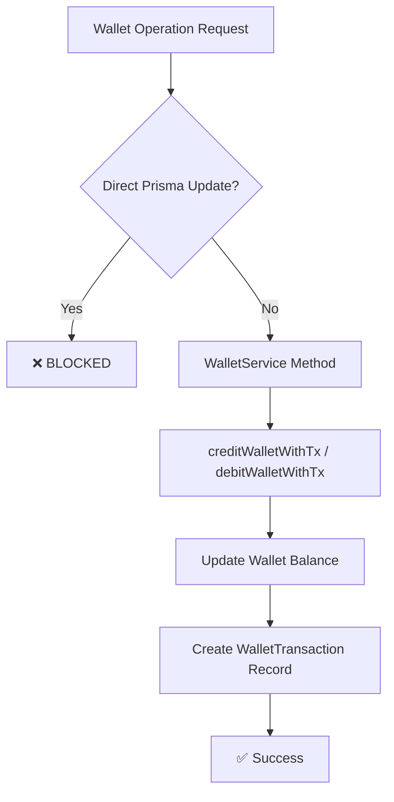

# Wallet Ledger Enforcement

## Overview

This lesson explains how the wallet ledger system ensures all wallet operations are tracked and auditable. Every wallet balance change must create a transaction record.

---

## Architecture



---

## Ledger Methods

### Credit Operation

```typescript
// src/wallet/wallet.service.ts
async creditWalletWithTx(
  tx: TransactionClient,
  userId: string,
  amount: Decimal,
  type: string = 'CREDIT',
  bookingId?: string,
  metadata?: any
): Promise<any> {
  // 1. Ensure wallet exists
  const wallet = await this.ensureWallet(userId, tx);

  // 2. Update balance atomically
  const updatedWallet = await tx.wallet.update({
    where: { id: wallet.id },
    data: { balance: { increment: amount } }
  });

  // 3. Create transaction record (CRITICAL)
  await tx.walletTransaction.create({
    data: {
      walletId: wallet.id,
      bookingId,
      type,
      amount,
      balanceAfter: updatedWallet.balance,
      metadata,
    },
  });

  return updatedWallet;
}
```

### Debit Operation

```typescript
async debitWalletWithTx(
  tx: TransactionClient,
  userId: string,
  amount: Decimal,
  type: string,
  bookingId?: string,
  metadata?: any
): Promise<any> {
  const wallet = await this.ensureWallet(userId, tx);
  const currentWallet = await tx.wallet.findUniqueOrThrow({ 
    where: { id: wallet.id } 
  });

  // Check sufficient balance
  if (currentWallet.balance.lessThan(amount)) {
    throw new BadRequestException('Insufficient balance');
  }

  // Update balance
  const updatedWallet = await tx.wallet.update({
    where: { id: wallet.id },
    data: { balance: { decrement: amount } }
  });

  // Create transaction record (CRITICAL)
  await tx.walletTransaction.create({
    data: {
      walletId: wallet.id,
      bookingId,
      type,
      amount: amount.neg(), // Store as negative for debits
      balanceAfter: updatedWallet.balance,
      metadata,
    },
  });

  return updatedWallet;
}
```

---

## Enforcement Rules

### ✅ Allowed Operations

1. **Through WalletService methods**:
   ```typescript
   await walletService.creditMechanic(mechanicId, amount);
   await walletService.debitWallet(userId, amount, 'PAYOUT');
   ```

2. **Within transactions**:
   ```typescript
   await walletService.creditWalletWithTx(tx, userId, amount);
   ```

### ❌ Blocked Operations

1. **Direct Prisma updates**:
   ```typescript
   // ❌ NEVER DO THIS
   await prisma.wallet.update({
     where: { id: walletId },
     data: { balance: { increment: amount } }
   });
   ```

2. **Bypassing transaction records**:
   ```typescript
   // ❌ NEVER DO THIS
   await prisma.wallet.update({ ... });
   // Missing: walletTransaction.create()
   ```

---

## WalletLedgerInterceptor

The interceptor monitors wallet operations and logs warnings:

```typescript
// src/common/interceptors/wallet-ledger.interceptor.ts
@Injectable()
export class WalletLedgerInterceptor implements NestInterceptor {
  intercept(context: ExecutionContext, next: CallHandler): Observable<any> {
    return next.handle().pipe(
      tap({
        next: (data) => {
          // Warn if wallet data returned without transaction records
          if (data?.balance && !data.WalletTransaction) {
            this.logger.warn('Potential direct wallet update detected');
          }
        },
      }),
    );
  }
}
```

---

## Testing Ledger Enforcement

### Unit Test Example

```typescript
// test/unit/services/wallet-ledger.spec.ts
describe('Wallet Ledger Enforcement', () => {
  it('should create transaction record for all credit operations', async () => {
    await service.creditWalletWithTx(mockTx, userId, amount);

    expect(mockTx.walletTransaction.create).toHaveBeenCalled();
  });

  it('should create transaction record for all debit operations', async () => {
    await service.debitWalletWithTx(mockTx, userId, amount, 'DEBIT');

    expect(mockTx.walletTransaction.create).toHaveBeenCalled();
  });
});
```

---

## Best Practices

1. **Always use WalletService methods**: Never update wallet balance directly
2. **Create transaction records**: Every balance change must have a record
3. **Use transactions**: Wrap operations in Prisma transactions for atomicity
4. **Include metadata**: Add context (bookingId, type, metadata) to transactions

---

## Exercises

1. **Audit Wallet Operations**: Search the codebase for any direct `prisma.wallet.update()` calls and refactor them to use WalletService.

2. **Write a Test**: Write a test that verifies a transaction record is created for every wallet operation.

3. **Add Metadata**: Update a wallet operation to include meaningful metadata.

---

## Related Documentation

- [WalletService Implementation](../../../src/wallet/wallet.service.ts)
- [WalletLedgerInterceptor](../../../src/common/interceptors/wallet-ledger.interceptor.ts)
