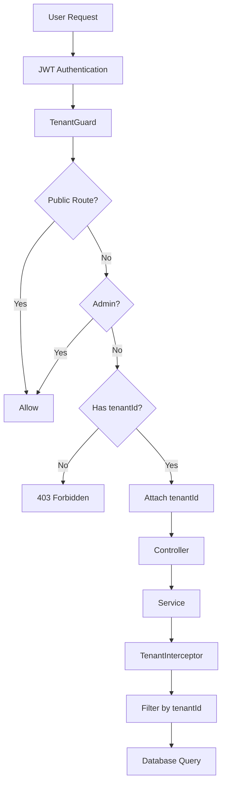

# Multi-Tenancy Implementation

## Overview

This lesson explains how multi-tenancy is implemented across the entire application.

---

## Architecture Diagram



---

## Key Components

1. **TenantGuard**: Enforces tenant isolation at route level
2. **TenantInterceptor**: Automatically filters queries
3. **@TenantId() Decorator**: Extracts tenantId from request
4. **@Public() Decorator**: Marks public routes

---

## Implementation Example

### Service Layer

```typescript
// organizations/organizations.service.ts
async findAll(tenantId: string) {
  return this.prisma.organization.findMany({
    where: {
      id: tenantId, // Filter by tenant
    },
  });
}
```

---

## Exercises

1. **Add Tenant Filtering**: Update a service to filter by tenantId.

2. **Test Isolation**: Write a test that verifies tenant isolation.

---

## Related Documentation

- [TenantGuard](../../../src/common/guard/tenant.guard.ts)
- [TenantInterceptor](../../../src/common/interceptors/tenant.interceptor.ts)
